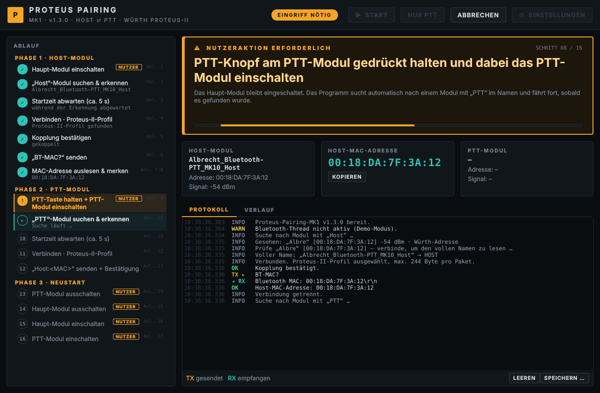

# Proteus-Pairing-MK1

**Version 1.3.0** · Desktop-Programm für Windows und macOS (keine Web-App)

Arbeitet den Paarungsablauf zwischen einem **Host-Modul** und einem **PTT-Modul** mit
Würth-Elektronik-**Proteus-II**-Bluetooth-Modulen automatisch ab – über die Bluetooth-Schnittstelle
des PCs/Macs. Das Programm ersetzt die Bedienung der Proteus-App auf dem Smartphone.



## Funktionen

- **Automatischer Ablauf** aller Schritte aus der Paarungsanleitung (`docs/Paarungsanleitung.txt`)
- **Universell nutzbar:** Geräte werden nur über die Erkennungsmarken **„Host“** und **„PTT“** im
  Gerätenamen erkannt (Groß-/Kleinschreibung egal). Enthält ein Name beide Marken
  (z. B. `…-PTT_MK10_Host`), gilt er als Host.
- **Gekürzte Namen werden erkannt:** Proteus-Module senden in der Suche oft nur einen
  gekürzten Namen (z. B. „Albre“) – der volle Name ist erst nach dem Verbinden sichtbar.
  Das Programm verbindet sich deshalb kurz mit jedem in Frage kommenden Modul (Proteus-UUID
  in der Werbung oder Würth-Adresse `00:18:DA:…`), liest den vollen Namen und prüft ihn auf
  „Host“/„PTT“. Passt er, wird die Verbindung direkt weiterverwendet. Erkannte Namen werden
  gespeichert (`namen_cache.json`), beim nächsten Mal entfällt die Prüfung.
- **Zuverlässige Kopplung (Windows):** Hat Windows für ein Modul noch eine alte Kopplung
  gespeichert, die das Modul nicht mehr kennt (z. B. weil es zwischendurch mit dem Handy
  gekoppelt war → „Insufficient Authentication“), wird sie automatisch entfernt und neu
  gekoppelt – wie es das Handy macht. Unterstützt „Nur bestätigen“, Zahlenvergleich und
  Passkey-Eingabe (Standard `123123`).
- **Gesicherte PTT-Konfiguration:** Das PTT-Modul wird nur verwendet, wenn es während
  Phase 2 frisch eingeschaltet wurde (mit gedrückter PTT-Taste = Einstellmodus). War es
  schon an, fordert das Programm zum Aus-/Einschalten auf und erkennt das automatisch.
  „Fertig“ gibt es erst, wenn das Modul mit „Neue Host MAC gespeichert“ antwortet –
  sonst Wiederholung bzw. klare Fehlermeldung.
- **Automatische Auswahl ohne Nutzerhandlung:** Suche, Verbindung, Auswahl des Proteus-II-Profils
  (Service `6E400001-C352-11E5-953D-0002A5D5C51B`), Kopplung, Befehle senden, Antwort auswerten.
  Sind mehrere passende Module in Reichweite, wird das mit dem stärksten Signal genommen.
- **Klare Nutzerhinweise:** Muss etwas von Hand erledigt werden (Modul einschalten, PTT-Taste
  halten, Neustart …), wird das in einer großen, orange blinkenden Karte „NUTZERAKTION
  ERFORDERLICH“ angezeigt, mit Signalton und Taskleisten-Hinweis. Die Schrittliste links
  markiert solche Schritte mit **NUTZER**.
- Ausgelesene **Host-MAC** groß angezeigt, kopierbar
- **Protokoll** aller gesendeten (TX) und empfangenen (RX) Daten, speicherbar
- **Verlauf** aller Paarungen (CSV im Benutzerordner)
- **Nur PTT:** MAC-Adresse von Hand eingeben und nur das PTT-Modul konfigurieren
- Fehler (z. B. Modul nicht gefunden, keine Antwort) mit „Wiederholen“ oder „Abbrechen“
- Alle Marken, Befehle, Zeiten und Optionen in den **Einstellungen** anpassbar

## Ablauf

| Programm | Anleitung | Art |
|---|---|---|
| Haupt-Modul einschalten | 1 | **Nutzer** (geht automatisch weiter, sobald das Modul gefunden wurde) |
| „Host“-Modul suchen & erkennen | 3 | automatisch (gekürzte Namen per kurzer Verbindung prüfen) |
| Startzeit abwarten (ca. 5 s) | 2 | automatisch |
| Verbinden · Proteus-II-Profil | 4 | automatisch |
| Kopplung bestätigen | 5 | automatisch (ggf. Systemdialog bestätigen) |
| „BT-MAC?“ senden | 6 | automatisch |
| MAC-Adresse auslesen & merken | 7–8 | automatisch |
| PTT-Taste halten + PTT-Modul einschalten | 9 | **Nutzer** (geht automatisch weiter, sobald das Modul gefunden wurde) |
| „PTT“-Modul suchen & erkennen | 11 | automatisch |
| Startzeit abwarten (ca. 5 s) | 10 | automatisch |
| Verbinden · Proteus-II-Profil | 12 | automatisch |
| „Host:&lt;MAC&gt;“ senden + Bestätigung | 13 | automatisch (wartet auf „… gespeichert“) |
| PTT-Modul aus / Haupt-Modul aus / Haupt-Modul ein / PTT-Modul ein | 14–17 | **Nutzer** (je „Erledigt“) |

## Download und Start

**Windows: eine einzige exe-Datei** – keine Installation, keine Ordner oder DLLs daneben.
Die exe kann an einem beliebigen Ort liegen (Desktop, USB-Stick …) und legt dort beim
Start keine Dateien an.

Per GitHub Actions entstehen (Reiter **Actions** → letzter Lauf, bzw. bei einem Tag `v*` im Release):

| Datei | Inhalt |
|---|---|
| `Proteus-Pairing-MK1-v1.3.0-windows.exe` | **nur die exe** – herunterladen und starten |
| `Proteus-Pairing-MK1-v1.3.0.zip` | Gesamtpaket: Windows-exe, macOS-App, README, Paarungsanleitung |
| `Proteus-Pairing-MK1-Offline-Build-Kit-v1.3.0.zip` | Offline-Build-Kit (siehe unten) |

> Hinweis: Unter **Actions** packt GitHub jedes Artefakt beim Herunterladen immer in eine
> ZIP-Hülle (`…-windows-exe.zip`, darin nur die exe). Im **Release** liegt die exe direkt.

- **Windows 10/11:** exe starten. Bluetooth muss eingeschaltet sein. Beim ersten Start kann der
  SmartScreen-Hinweis erscheinen („Weitere Informationen“ → „Trotzdem ausführen“).
- **macOS (Apple Silicon, ab macOS 14 Sonoma):** `Proteus-Pairing-MK1-macOS.zip` aus dem Gesamtpaket
  entpacken, App per Rechtsklick → „Öffnen“ starten (nicht signiert). Bluetooth-Zugriff beim
  ersten Start erlauben. Falls macOS die App blockiert: `xattr -cr Proteus-Pairing-MK1.app`.

Einstellungen, Verlauf (`verlauf.csv`), Namensspeicher (`namen_cache.json`) und gespeicherte Protokolle liegen unter
`%APPDATA%\Proteus-Pairing-MK1` (Windows) bzw. `~/Library/Application Support/Proteus-Pairing-MK1` (macOS).

## Einstellungen

| Einstellung | Standard | Bedeutung |
|---|---|---|
| Marke Host-Modul / PTT-Modul | `Host` / `PTT` | Teil des Gerätenamens zur Erkennung |
| Gekürzte Namen per Verbindung prüfen | an | Kandidaten kurz verbinden und vollen Namen lesen |
| Namensanfang prüfen | leer | zusätzlich alle Geräte mit diesem (gekürzten) Namensanfang prüfen, z. B. `Albre` – nötig unter macOS, falls das Modul keine Proteus-UUID sendet (macOS zeigt keine MAC-Adressen) |
| MAC-Abfrage am Host | `BT-MAC?` | Befehl an das Host-Modul |
| Präfix am PTT-Modul | `Host:` | wird mit der MAC zu `Host:00:18:DA:…` |
| Bestätigung PTT-Modul | `gespeichert` | muss in der Antwort vorkommen („Neue Host MAC gespeichert“); leer = nicht prüfen |
| Zeilenende | kein | wie in der Proteus-App; bei Bedarf CR / LF / CR+LF |
| Proteus-II-Datenheader 0x01 | an | Proteus-II-Profil: jedes Datenpaket beginnt mit 0x01 |
| Startzeit nach Erkennen | 5 s | „ca. 5 s warten“ |
| Max. Suchdauer | 120 s | danach Fehlermeldung mit „Wiederholen“ |
| Wartezeit vor dem Senden | 1 s | nach dem Öffnen des Datenkanals, bevor ein Befehl gesendet wird |
| Antwort-Timeout / Wiederholungen | 5 s / 3 | für MAC-Abfrage und PTT-Bestätigung |
| Kopplung Host / PTT | an / aus | Kopplung anfordern (Schritt 5) |
| Vorhandene Windows-Kopplung vorher entfernen | an | alte Kopplung löschen und neu koppeln (verhindert „Insufficient Authentication“) |
| Passkey (falls verlangt) | `123123` | wird automatisch eingegeben, wenn das Modul einen Passkey verlangt |
| Kopplung danach entfernen | aus | nur Windows; hält die Bluetooth-Geräteliste sauber |
| PTT-Modul erst nach Aus-/Einschalten verwenden | an | verhindert, dass ein noch laufendes PTT-Modul (Normalbetrieb) verwendet wird |
| Neustart-Schritte einzeln bestätigen | an | sonst eine Sammelbestätigung für Schritt 14–17 |

## Offline bauen (ohne Internet am Build-Rechner)

Im Ordner [`offline_build_kit`](offline_build_kit/ANLEITUNG.md) liegt ein
Offline-Build-Kit für **Windows und macOS**: ein Mac mit Internet lädt alle Pakete,
der Offline-Rechner baut – mit derselben Spec-Datei wie GitHub Actions.

| Schritt | Windows-exe | macOS-App |
|---|---|---|
| 1 – Mac mit Internet | `1_mac_pakete_herunterladen.sh` (lädt beides; `windows` bzw. `mac` für nur eins) | ← dasselbe |
| 2 – Offline-Rechner | `2_win10_pakete_installieren.bat` | `bash 2_mac_pakete_installieren.sh` |
| 3 – Offline-Rechner | `3_win10_exe_bauen.bat` | `bash 3_mac_app_bauen.sh` |
| Ergebnis | `fertige_exe/…-v<Version>-windows.exe` | `fertige_app/….app` + `…-v<Version>-macOS.zip` |

Voraussetzung: Windows 10/11 mit Python 3.11 (64-Bit) bzw. macOS 14+ mit Python 3.10–3.14.
Details, beide Wege (Projektordner oder Kit + ZIP) und Fehlerbehebung:
[`offline_build_kit/ANLEITUNG.md`](offline_build_kit/ANLEITUNG.md).
Das Kit wird außerdem bei jedem Release als eigene ZIP mitgeliefert.

## Selbst bauen

```bash
pip install -r requirements.txt pyinstaller==6.22.3
python main.py                                        # direkt starten
pyinstaller --noconfirm --clean Proteus-Pairing-MK1.spec   # exe bzw. .app in dist/
```

Projektstruktur:

```
main.py                      Startpunkt
app/config.py                Version, Einstellungen, Verlauf
app/engine.py                Ablaufsteuerung + Bluetooth LE (bleak)
app/winpair.py               Windows-Kopplung (alte Kopplung entfernen, Passkey)
app/gui.py                   Oberfläche (PySide6/Qt)
app/style.py                 Farbschema im Dashboard-Design
assets/                      Programmsymbol (png/ico/icns)
tools/make_icon.py           erzeugt die Symbole neu
docs/                        Screenshot, Paarungsanleitung
.github/workflows/build.yml  Build Windows-exe + macOS-App + Gesamt-ZIP + Offline-Kit-ZIP
offline_build_kit/           Offline-Build-Kit (Mac lädt, Win10 baut exe / Mac baut App)
```

Technik: Python 3.12 (Offline-Kit: 3.11), PySide6-Essentials 6.12 (Qt 6), bleak 3.1 (WinRT unter Windows, CoreBluetooth unter macOS),
PyInstaller.
